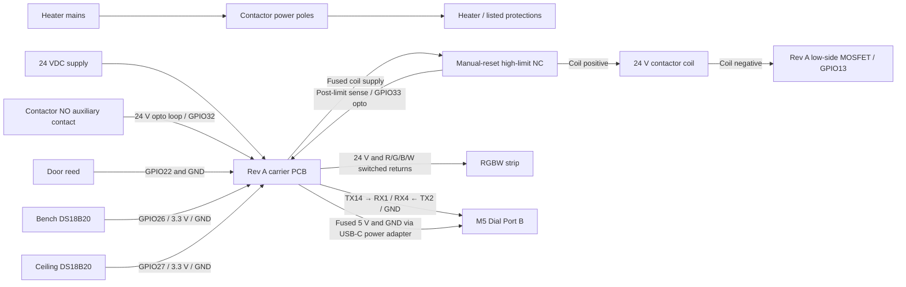

# AW Rev A wiring reference

For the assembled Rev A box on `aw-install`. The firmware pin map is in
[`sauna-controller.yaml`](../sauna-controller.yaml); board connector numbering
comes from the [Rev A schematic](../pcb/rev-a/sauna-controller.kicad_sch).
This diagram shows functional connections, not mains conductor sizing or a
replacement for the installer-reviewed electrical drawing.

## Rev A GPIO map

| Function | ESP32 GPIO | Field connection |
|---|---|---|
| Contactor coil drive | 13 | Board MOSFET switches coil negative; high-limit remains in series with coil positive. |
| Red / green / blue / white | 16 / 17 / 18 / 19 | RGBW switched negative outputs; strip common positive uses fused 24 V. |
| Door | 22 | Reed to GND; closed = low. |
| Auxiliary feedback | 32 | Opto input; closed auxiliary = low. Never connect 24 V directly to GPIO. |
| High-limit status | 33 | Opto input; healthy powered loop = low, open/tripped = high. |
| Bench probe | 26 | Dedicated One-Wire bus, 3.3 V and GND. |
| Ceiling probe | 27 | Dedicated One-Wire bus, 3.3 V and GND. |
| Panel TX / RX | 14 / 4 | Cross to Dial GPIO1 RX / GPIO2 TX. |
| Board FAULT LED | 25 | Mirrors the latched firmware fault. |

Use the PCB's regulated 5 V supply for the ESP32 VIN. Both temperature probes
use 3.3 V, not 24 V. Keep low-voltage ground common; keep mains/low-voltage
wiring physically separated. The Dial wiring and power options are in the
[installation instructions](../README.md#1-connect-the-dial).

## Board connector pins

Numbering verified against the checked-in Rev A KiCad netlist. Use the PCB's
pin-1 marking, not an assumed left/right orientation when looking into the box.

| Connector | Pins |
|---|---|
| `J_PWR1` | 1 = +24 V input, 2 = GND |
| `J_PANEL1` | 1 = TX (GPIO14), 2 = RX (GPIO4), 3 = fused +5 V, 4 = GND |
| `J_COIL1` | 1 = fused +24 V to high-limit, 2 = return from high-limit / coil positive, 3 = switched coil negative |
| `J_AUX1` | 1 and 2 = contactor NO auxiliary dry-contact loop (board supplies the wetting current) |
| `J_DOOR1` | 1 = door reed input, 2 = GND |
| `J_BENCH1` / `J_CEILING1` | 1 = 3.3 V, 2 = data, 3 = GND |
| `J_LED1` | 1 = R−, 2 = G−, 3 = B−, 4 = W−, 5 = fused +24 V |

For permanent Dial power, connect `J_PANEL1` pin 3 (+5 V) and pin 4 (GND) to a
suitable USB-C power lead/adapter. Disconnect this feed when using computer USB
for flashing. Leave the Dial Port B red wire disconnected: the manufacturer's
[schematic, page 2](https://m5stack-doc.oss-cn-shenzhen.aliyuncs.com/499/Sch_M5Dial.pdf)
places it on `+5VOUT` behind D8, not on the input supply.

Route the high-limit between `J_COIL1` pins 1 and 2, with the coil between pins
2 and 3; never bridge out the high-limit.
